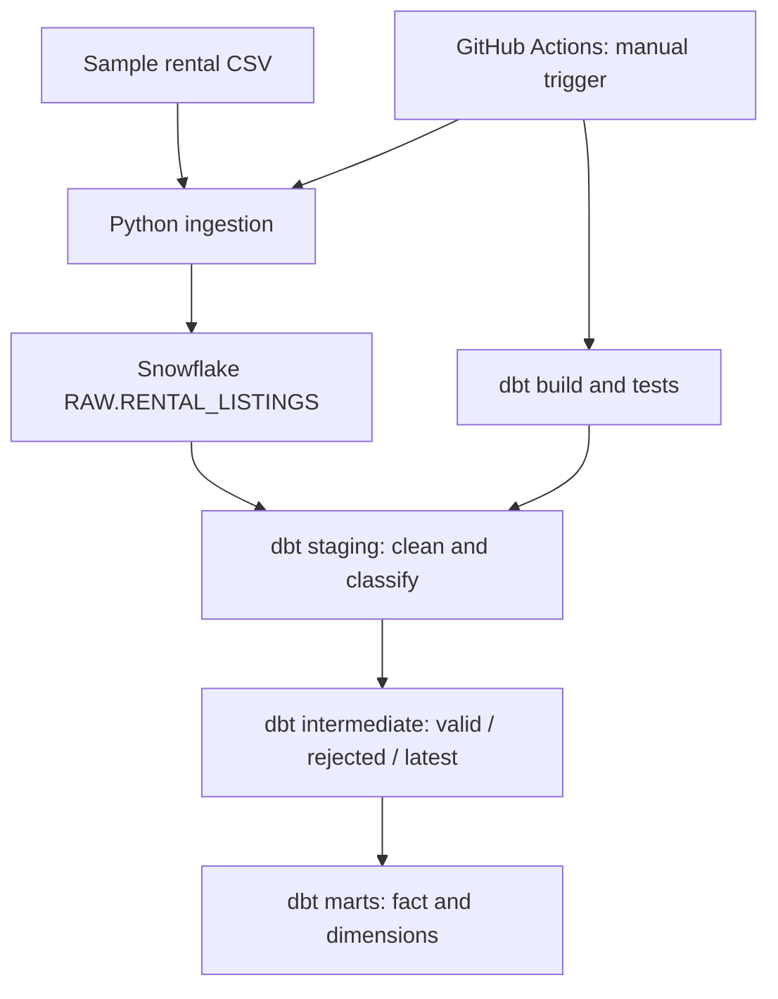

# 🏠 Student Rental Intelligence

**An end-to-end Data Engineering mini-project for exploring student rental listings in Wollongong, Australia.**

[](https://github.com/AnTran289/student-rental-intelligence/actions/workflows/rental_pipeline.yml)

> **Project status:** End-to-end MVP implemented. The current pipeline uses **synthetic rental observations** for learning and demonstration; its outputs must not be interpreted as current rental prices or real-world listing availability.

## Overview

Students searching for accommodation often encounter rental listings spread across different platforms, with inconsistent descriptions, duplicate observations, and different advertised prices. This project explores how to turn those observations into a consistent, queryable analytics dataset.

The focus is on **data engineering**, rather than building a rental marketplace or predicting rental availability: ingestion, data validation, warehouse modelling, transformations, testing, and workflow orchestration.

## Architecture



**Execution order:** GitHub Actions installs dependencies, runs the Python ingestion entry point, checks the dbt connection, and builds the selected dbt models and their tests.

## Tech stack

| Layer | Technology | Purpose |
|---|---|---|
| Ingestion | Python, `csv` | Read and validate rental observations |
| Warehouse | Snowflake | Persist raw observations and analytics models |
| Transformations | dbt | Clean, classify, deduplicate, and model listings |
| Data quality | dbt tests, pytest | Validate model constraints and ingestion behaviour |
| Orchestration | GitHub Actions | Manually trigger an end-to-end pipeline |
| Credentials | GitHub Actions Secrets | Supply Snowflake connection details without committing passwords |

## Data model and grain

- **RAW grain:** one row per ingested observation, identified by `RAW_RECORD_ID`.
- **Business listing key:** `SOURCE_PLATFORM` + `SOURCE_LISTING_ID`. Multiple observations may refer to the same listing.
- **Latest-listing grain:** one row per business listing key, selected from valid observations.
- **Fact model:** `fct_rental_listings`, containing the latest valid listing observations, rental attributes, and a generated `listing_key`.
- **Dimension model:** `dim_suburbs`, containing distinct suburbs and a generated `suburb_key`.

The latest-observation model uses `ROW_NUMBER()` partitioned by source platform and source listing ID, ordered by collection timestamp, ingestion timestamp, and raw record ID. This avoids treating repeated observations as separate active listings in the fact model.

### Data quality approach

The staging layer standardises source fields and parses advertised weekly rent. Records are classified as `VALID` or `REJECTED` with a rejection reason, including missing listing identifiers, missing suburbs, invalid rents, and non-positive rents. Valid observations feed the latest-listing model; rejected observations remain available for inspection through the intermediate rejection model.

**Important distinction:** Python ingestion validates technical requirements needed to load a batch; dbt handles downstream business-level quality checks. The demonstration CSV contains loadable records. The larger synthetic seed dataset is a separate dbt demonstration input and includes deliberately invalid examples.

## Ingestion behaviour

The loader uses an **insert-only Snowflake `MERGE`** and compares incoming observations against existing records using `RAW_RECORD_ID`:

| Condition | Behaviour |
|---|---|
| New `RAW_RECORD_ID` | Insert observation |
| Existing ID with identical data | Skip without inserting a duplicate |
| Existing ID with conflicting data | Raise an error and roll back the batch |

This makes repeat runs idempotent for identical input data. It does **not** imply concurrency-safe uniqueness enforcement across simultaneous writers; concurrent ingestion is outside the MVP scope.

## Running the project

### Prerequisites

- Python 3.12 (used by the GitHub Actions workflow)
- Access to a Snowflake account with an appropriate warehouse, database, and role
- Python dependencies in `requirements.txt`

### Local ingestion

```bash
python -m pip install -r requirements.txt
python run_ingestion.py --file data/ingestion_sample.csv
```

The connection module reads these environment variables:

```text
SNOWFLAKE_ACCOUNT
SNOWFLAKE_USER
SNOWFLAKE_PASSWORD
SNOWFLAKE_WAREHOUSE
SNOWFLAKE_DATABASE
SNOWFLAKE_SCHEMA
SNOWFLAKE_ROLE
```

Store them locally in a private `.env` file or supply them through the environment. **Never commit credentials.** The code assumes the Snowflake RAW table and relevant privileges have already been provisioned; the repository does not currently provide an automated infrastructure setup.

### Run Python unit tests

```bash
python -m pytest tests/ -v
```

This command runs the tests in `tests/` without invoking the separate live Snowflake integration script.

### Run dbt locally

Configure a private dbt `profiles.yml` matching the `default` profile in `dbt_project.yml`, with Snowflake credentials and a schema where the selected role can create objects. Then run:

```bash
dbt debug
dbt build --select stg_rental_listings+
```

The `+` selector includes downstream models dependent on `stg_rental_listings`. The synthetic seed-based analytics models are separate from this ingestion-driven build path.

### Run with GitHub Actions

1. Configure repository secrets: `SNOWFLAKE_ACCOUNT`, `SNOWFLAKE_USER`, and `SNOWFLAKE_PASSWORD`.
2. Ensure the Snowflake user can use the ingestion role (`STUDENT_RENTAL_INGEST`) and dbt role (`STUDENT_RENTAL_DBT`), with appropriate privileges.
3. Open **Actions → Student Rental Pipeline → Run workflow** on the `main` branch.
4. Review the ingestion and dbt build logs.

The workflow runs dbt models in the separate `DBT_CI` schema, avoiding overwriting the dbt Cloud development models in `DBT_DEV`.

## Validation milestone

In a verified GitHub Actions run on **21 October 2026**, the workflow completed successfully. The selected dbt build reported:

- **4 view models**
- **2 table models**
- **24 data tests**
- **30/30 successful operations**, with zero warnings and zero errors

The ingestion entry point was also verified locally against Snowflake: new records were inserted, identical records were skipped on rerun, and conflicting observations were rejected without overwriting the original record.

See the [GitHub Actions workflow](https://github.com/AnTran289/student-rental-intelligence/actions/workflows/rental_pipeline.yml) for execution details.

## Repository structure

```text
student-rental-intelligence/
├── .github/workflows/rental_pipeline.yml
├── data/ingestion_sample.csv
├── ingestion/                 # CSV reading, validation, Snowflake loading
├── models/
│   ├── staging/
│   ├── intermediate/
│   └── marts/
├── seeds/                     # Separate synthetic dbt seed dataset
├── tests/                     # Python unit tests and dbt project tests
├── dbt_project.yml
├── requirements.txt
└── run_ingestion.py
```

## Scope and limitations

- **Synthetic data only:** results are not representative of the live Wollongong rental market.
- **Manual execution:** GitHub Actions uses `workflow_dispatch`, not a scheduled or continuously running trigger.
- **No live scraping:** the MVP does not collect listings automatically from Facebook or rental platforms.
- **Single-writer assumption:** the loader is designed for controlled batch runs, not concurrent writers.
- **No dashboard or prediction engine:** the emphasis is a reliable, understandable analytics data pipeline.

## What I learned

This project gave me hands-on practice with designing observation-level data grain, separating technical and business validation, building idempotent ingestion, modelling facts and dimensions, testing transformations, and running Python plus dbt in a single GitHub Actions workflow. It also reinforced why reproducibility, traceability, and least-privilege access matter in Data Engineering.

---

**Built as a learning and portfolio project.** Feedback and suggestions are welcome.
