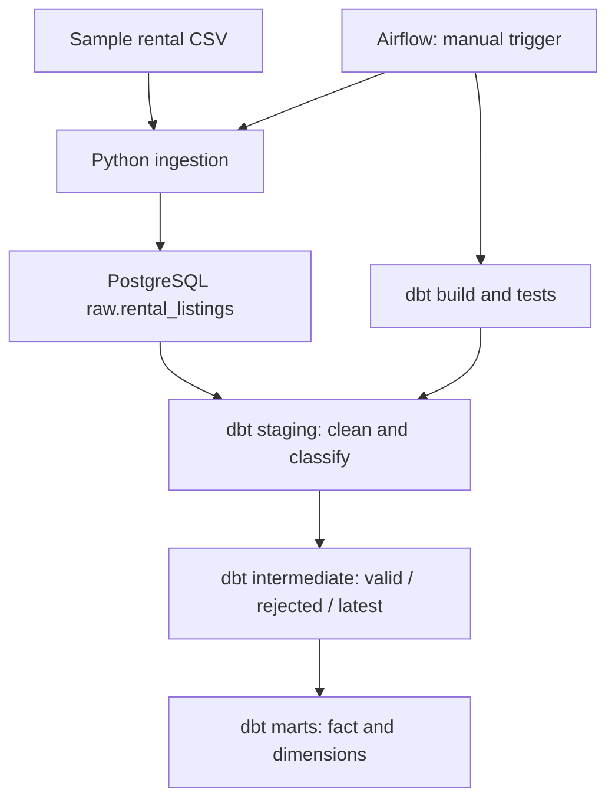

# 🏠 Student Rental Intelligence

**An end-to-end Data Engineering mini-project for exploring student rental listings in Wollongong, Australia.**

[](https://github.com/AnTran289/student-rental-intelligence/actions/workflows/rental_pipeline.yml)

> **Project status:** End-to-end MVP implemented. The current pipeline uses **synthetic rental observations** for learning and demonstration; its outputs must not be interpreted as current rental prices or real-world listing availability.

## Overview

Students searching for accommodation often encounter rental listings spread across different platforms, with inconsistent descriptions, duplicate observations, and different advertised prices. This project explores how to turn those observations into a consistent, queryable analytics dataset.

The focus is on **data engineering**, rather than building a rental marketplace or predicting rental availability: ingestion, data validation, warehouse modelling, transformations, testing, and workflow orchestration.

## Architecture



**Execution order:** Airflow runs input validation, Python ingestion, dbt build, and final batch reconciliation.

## Tech stack

| Layer | Technology | Purpose |
|---|---|---|
| Ingestion | Python, `csv` | Read and validate rental observations |
| Warehouse | PostgreSQL | Persist raw observations and analytics models |
| Transformations | dbt | Clean, classify, deduplicate, and model listings |
| Data quality | dbt tests, pytest | Validate model constraints and ingestion behaviour |
| Orchestration | Apache Airflow | Manually trigger an end-to-end pipeline |
| Credentials | Local environment variables | Configure rental PostgreSQL and Airflow metadata access |

## Data model and grain

- **RAW grain:** one row per ingested observation, identified by `RAW_RECORD_ID`.
- **Business listing key:** `SOURCE_PLATFORM` + `SOURCE_LISTING_ID`. Multiple observations may refer to the same listing.
- **Latest-listing grain:** one row per business listing key, selected from valid observations.
- **Fact model:** `fct_rental_listings`, containing the latest valid listing observations, rental attributes, and a generated `listing_key`.
- **Dimension model:** `dim_suburbs`, containing distinct suburbs and a generated `suburb_key`.

The latest-observation model uses `ROW_NUMBER()` partitioned by source platform and source listing ID, ordered by collection timestamp and raw record ID. This avoids treating repeated observations as separate active listings in the fact model.

### Data quality approach

The staging layer standardises source fields and parses advertised weekly rent. Records are classified as `VALID` or `REJECTED` with a rejection reason, including missing listing identifiers, missing suburbs, invalid rents, and non-positive rents. Valid observations feed the latest-listing model; rejected observations remain available for inspection through the intermediate rejection model.

**Important distinction:** Python ingestion validates technical requirements needed to load a batch; dbt handles downstream business-level quality checks. The demonstration CSV contains loadable records. The larger synthetic seed dataset is a separate dbt demonstration input and includes deliberately invalid examples.

## Ingestion behaviour

The loader uses a **transactional PostgreSQL lookup and insert** and compares incoming observations against existing records using `RAW_RECORD_ID`:

| Condition | Behaviour |
|---|---|
| New `RAW_RECORD_ID` | Insert observation |
| Existing ID with identical data | Skip without inserting a duplicate |
| Existing ID with conflicting data | Raise an error and roll back the batch |

This makes repeat runs idempotent for identical input data. It does **not** imply concurrency-safe uniqueness enforcement across simultaneous writers; concurrent ingestion is outside the MVP scope.

## Running the project

### Prerequisites and configuration

Use Docker with Compose v2. Python 3.12 is the CI version and is recommended for host CLI commands and unit tests.

Copy `.env.example` to `.env`. Keep `POSTGRES_DB=student_rental_db` for fresh bootstrap and replace every secret placeholder. Use different passwords for the rental and Airflow metadata databases. Use independent random values for the JWT and internal API secrets. Generate a URL-safe Fernet key from 32 random bytes, for example:

```bash
python -c "import base64,os; print(base64.urlsafe_b64encode(os.urandom(32)).decode())"
```

Save the generated key in the local `.env` file. Compose reads that file for interpolation. The host Python runner reads its process environment, so export the values separately for host commands.

### Start PostgreSQL and Airflow

Run these commands from the repository root:

```bash
docker compose -f docker-compose.yml config --quiet
docker compose -f docker-compose.airflow.yml config --quiet
docker compose -f docker-compose.yml up -d --wait postgres
docker build -f Dockerfile.airflow -t student-rental-airflow:dev .
docker compose -f docker-compose.airflow.yml up -d --wait airflow-postgres
docker compose -f docker-compose.airflow.yml up --exit-code-from airflow-init airflow-init
docker compose -f docker-compose.airflow.yml up -d airflow-api-server airflow-scheduler airflow-dag-processor
```

The rental PostgreSQL container initializes `student_rental_db` and `student_rental_test_db` on a fresh volume. Each database starts with an empty `raw.rental_listings` table and a primary key on `raw_record_id`. A populated volume keeps its existing schema and data. Confirm `airflow-init` exits successfully before starting the remaining services.

The default host addresses are `127.0.0.1:5433` for rental PostgreSQL and `http://127.0.0.1:8080` for Airflow. The scheduler connects to rental PostgreSQL through the container alias `student-rental-postgres:5432`. The two stacks use separate databases for rental data and Airflow metadata.

For the local Airflow UI, use the configured `admin` account and its generated password in `airflow/config/simple_auth_manager_passwords.json.generated`. Keep that file private.

For a side-by-side rehearsal, choose distinct project names with `-p` for both stacks and use a separate checkout or bind-mount directory for Airflow logs and configuration. Set `RENTAL_NETWORK_NAME` to `<rental-project>_default` and override `RENTAL_POSTGRES_HOST_PORT` and `AIRFLOW_WEB_PORT` to unused ports. Start the rental project before the Airflow project.

### Verify dbt and Airflow

```bash
docker compose -f docker-compose.airflow.yml exec -T airflow-dag-processor airflow dags list-import-errors --local --output json
docker compose -f docker-compose.airflow.yml exec -T airflow-scheduler /opt/dbt-venv/bin/dbt debug --project-dir /opt/airflow/student-rental --profiles-dir /opt/airflow/student-rental/airflow/dbt --target local
```

Expect an empty import-error list and a successful PostgreSQL connection check. The DAG `student_rental_pipeline` is manual. Its default routing uses the development database and the bundled dbt profile uses schema `dbt_dev`. For an isolated pipeline run, set both `POSTGRES_DB` and `RENTAL_DB_NAME` to `student_rental_test_db` on the scheduler and use a temporary dbt profile with a dedicated base schema and its `_synthetic` companion.

### Host ingestion and tests

```bash
python -m pip install -r requirements.txt
python -m pytest -q \
  tests/test_csv_reader.py tests/test_validators.py tests/test_record_preparation.py \
  tests/test_ingestion_validation.py tests/test_validate_csv.py tests/test_pipeline_validation.py
```

GitHub Actions runs these six unit suites on push and pull request without database credentials or services.

For host ingestion, set `POSTGRES_HOST` (default `127.0.0.1`), `POSTGRES_PORT` (default `5433`), `POSTGRES_USER`, `POSTGRES_PASSWORD`, and `POSTGRES_DB=student_rental_test_db` in the Python process environment before running `python run_ingestion.py --file data/ingestion_sample.csv`. Match `POSTGRES_PORT` to the published port when using an override.

Run `python -m pytest -q tests/test_postgres_loader_integration.py` separately with that host, port, and user configuration. It connects only to `student_rental_test_db` and commits a test observation there.


## Historical Snowflake validation milestone

In a verified GitHub Actions run on **21 October 2026**, the workflow completed successfully. The selected dbt build reported:

- **4 view models**
- **2 table models**
- **24 data tests**
- **30/30 successful operations**, with zero warnings and zero errors

The ingestion entry point was also verified locally against Snowflake: new records were inserted, identical records were skipped on rerun, and conflicting observations were rejected without overwriting the original record.

The earlier Snowflake workflow remains in Git history. The current workflow runs Python unit tests.

## Repository structure

```text
student-rental-intelligence/
├── .github/workflows/rental_pipeline.yml
├── airflow/                   # DAGs and environment-based dbt profile
├── data/ingestion_sample.csv
├── ingestion/                 # CSV reading, validation, PostgreSQL loading
├── models/
│   ├── staging/
│   ├── intermediate/
│   └── marts/
├── seeds/                     # Separate synthetic dbt seed dataset
├── postgres/init/             # Bootstrap for fresh rental database volumes
├── tests/                     # Python unit tests and dbt project tests
├── dbt_project.yml
├── requirements.txt
└── run_ingestion.py
```

## Scope and limitations

- **Synthetic data only:** results are not representative of the live Wollongong rental market.
- **Manual execution:** The Airflow DAG has no schedule.
- **No live scraping:** the MVP does not collect listings automatically from Facebook or rental platforms.
- **Single-writer assumption:** the loader is designed for controlled batch runs, not concurrent writers.
- **No dashboard or prediction engine:** the emphasis is a reliable, understandable analytics data pipeline.

## What I learned

This project gave me hands-on practice with designing observation-level data grain, separating technical and business validation, building idempotent ingestion, modelling facts and dimensions, testing transformations, and orchestrating Python and dbt with Airflow. It also reinforced why reproducibility, traceability, and least-privilege access matter in Data Engineering.

---

**Built as a learning and portfolio project.** Feedback and suggestions are welcome.
