# Student Rental Intelligence

An end-to-end data engineering portfolio project for historical advertised prices for student-oriented rentals around Wollongong, Australia. It takes CSV observations through transactional ingestion, dimensional modelling, and an orchestrated batch quality check. The sample dataset is for learning. It cannot support representative market research or real-time listing availability.

**Tech stack** · Python · PostgreSQL · dbt · Apache Airflow · Docker · GitHub Actions

## Engineering highlights

- **Transactional Python ingestion into PostgreSQL.** The loader inserts new observation IDs and skips exact replays. If it finds different data under an existing ID, it raises an error and rolls back the current ingestion transaction before commit. Previously committed observations are unaffected.
- **dbt transformations and dimensional modelling.** Staging cleans and classifies records, rejected observations remain inspectable, and the fact table represents the latest valid observation per listing.
- **Apache Airflow 3 orchestration.** Four tasks validate the CSV, ingest it, run dbt, and reconcile the batch against the current build’s outputs.
- **Automated Python unit tests.** GitHub Actions is configured to run six suites on pushes and pull requests without external services or credentials.

## Architecture

```mermaid
flowchart TD
    subgraph rentalFlow ["Rental observation data flow"]
        csv["Sample rental CSV"] --> python["Python validation and transactional ingestion"]
        python --> raw["PostgreSQL raw.rental_listings"]
        raw --> staging["dbt staging: clean and classify"]
        staging --> valid["Valid observations"]
        staging --> rejected["Rejected observations and reasons"]
        valid --> latest["Latest valid observation per listing"]
        latest --> fact["fct_rental_listings"]
        latest --> dimension["dim_suburbs"]
    end

    subgraph syntheticFlow ["Separate synthetic data flow"]
        seed["Synthetic CSV seed"] --> synthModels["dbt synthetic staging, valid and latest models"]
        synthModels --> aggregates["Rent by suburb, room type and price band"]
    end

    subgraph orchestration ["Airflow task order"]
        validateInput["validate_input"] -.-> ingestRentals["ingest_rentals"]
        ingestRentals -.-> dbtBuild["dbt_build"]
        dbtBuild -.-> validatePipeline["validate_pipeline"]
    end
```



Solid arrows show data lineage. Dotted arrows show task dependencies. The dbt task builds both branches. See the [architecture and verification notes](docs/architecture.md) for model grain and run evidence.

## Data model and quality

- **Observation key:** `raw_record_id` is the primary key of `raw.rental_listings`. Several observations can share the listing business key `(source_platform, source_listing_id)`.
- **Latest valid listing:** dbt selects one valid observation per business key using `collected_at DESC NULLS LAST`, then `raw_record_id DESC` for deterministic ties.
- **Rejections:** dbt retains rejected observations and their reasons, including missing identifiers, missing suburbs, and invalid or non-positive rents.
- **Batch reconciliation:** Airflow checks the current CSV batch. Inserted plus skipped must equal its validated row count, and each of its observation IDs must appear exactly once across the valid and rejected views combined. Airflow also checks that the fact table is readable. Mixed batches can pass. All-rejected batches fail.

## Getting started

Use Docker with Compose v2. Use Python 3.12 for host CLI commands and tests.

Copy [`.env.example`](.env.example) to `.env`, keep `POSTGRES_DB=student_rental_db` for first-time bootstrap, and replace the secret placeholders. Use separate PostgreSQL passwords and independent random values for the Airflow JWT and internal API secrets. Generate the Fernet key locally:

```bash
python -c "import base64,os; print(base64.urlsafe_b64encode(os.urandom(32)).decode())"
```

Compose reads `.env` for interpolation. Export connection variables separately for host Python commands.

### Start PostgreSQL and Airflow

Run from the repository root. Continue past `airflow-init` only if it exits successfully.

```bash
docker compose -f docker-compose.yml config --quiet
docker compose -f docker-compose.airflow.yml config --quiet
docker compose -f docker-compose.yml up -d --wait postgres
docker build -f Dockerfile.airflow -t student-rental-airflow:dev .
docker compose -f docker-compose.airflow.yml up -d --wait airflow-postgres
docker compose -f docker-compose.airflow.yml up --exit-code-from airflow-init airflow-init
docker compose -f docker-compose.airflow.yml up -d airflow-api-server airflow-scheduler airflow-dag-processor
```

A fresh rental volume gets `student_rental_db` and `student_rental_test_db`, each with an empty `raw.rental_listings` table. Bootstrap leaves populated volumes intact. Airflow uses a separate metadata database.

### Verify and trigger manually

```bash
docker compose -f docker-compose.airflow.yml exec -T airflow-dag-processor airflow dags list-import-errors --local --output json
docker compose -f docker-compose.airflow.yml exec -T airflow-dag-processor airflow dags list --local --columns dag_id --output json
docker compose -f docker-compose.airflow.yml exec -T airflow-scheduler /opt/dbt-venv/bin/dbt debug --project-dir /opt/airflow/student-rental --profiles-dir /opt/airflow/student-rental/airflow/dbt --target local
```

Expect `[]` for import errors, `student_rental_pipeline` in the DAG list, and a successful dbt connection check. Open the Airflow UI at `http://127.0.0.1:8080`. Sign in as `admin` using the generated password in the private local file `airflow/config/simple_auth_manager_passwords.json.generated`. Select `student_rental_pipeline`, unpause it if needed, then trigger it manually.

**Check the target before triggering.** Ingestion and dbt default to `student_rental_db`, and dbt uses `dbt_dev` plus `dbt_dev_synthetic`. For an isolated run, override both database variables on the scheduler service and point it to a temporary dbt profile with an isolated schema. Verify the effective database and resolved schemas before triggering. See the [isolated setup notes](docs/architecture.md#isolated-local-runs).

## Testing and evidence

```bash
python -m pip install -r requirements.txt
python -m pytest -q \
  tests/test_csv_reader.py tests/test_validators.py tests/test_record_preparation.py \
  tests/test_ingestion_validation.py tests/test_validate_csv.py tests/test_pipeline_validation.py
```

**Locally verified:** 43 Python unit tests passed on Python 3.12, and one PostgreSQL integration test passed against a separate test database. The [unit CI workflow](.github/workflows/rental_pipeline.yml) runs the six suites above. A hosted run of this workflow has yet to be verified.

| Scheduler-managed test run | Inserted | Skipped | Valid | Rejected | dbt |
|---|---:|---:|---:|---:|---|
| Fresh batch | 3 | 0 | 2 | 1 | 12 models, 2 seeds, 44 tests passed |
| Replay | 0 | 3 | 2 | 1 | 12 models, 2 seeds, 44 tests passed |

All four Airflow tasks passed in each run, for **eight successful task executions**. The runs used persisted upstream XComs and separate current-run dbt artifacts. See the [run identifiers and checks](docs/architecture.md#local-verification-evidence) and [host CLI and integration commands](docs/architecture.md#host-ingestion-and-integration-test).

## Limitations

- The educational sample is too small for representative market research or live availability inference.
- Synthetic analytics use their own seed data. They do not derive from actual rental observations.
- Deployment is local Docker. Fresh-stack bootstrap, DAG discovery, and dbt connectivity were verified separately from the full DAG E2E runs. A full clean-clone DAG E2E is still unverified.
- Sequential replay is verified. Concurrent writers and automatic task retry recovery remain untested.
